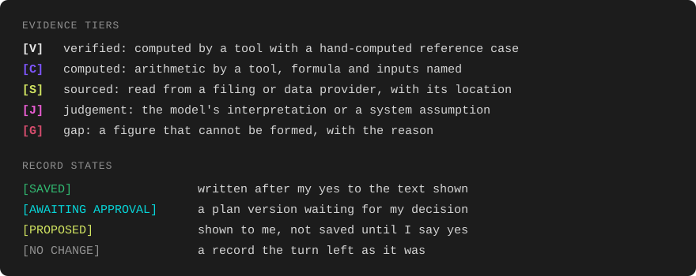

# Portfolio Management and Research Assistant

> This is a showcase repository. The full project and its source code are private; the
> [examples](examples/) folder holds a few complete modules with their tests.

I built an AI research assistant for my own investing. It reviews my portfolio, screens
companies and researches them in depth, working from my investment policy statement (IPS),
my investment philosophy and my notes. One orchestrating model plans the work and calls
tools. Deterministic code computes every figure, enforces my policy and my spending limits,
and records where each number came from. The model reads, weighs and explains; it never does
the arithmetic.

The first version was a multi-agent system with specialised agents for data, portfolio
analysis, compliance, screening, the ledger and research. I replaced it with one
orchestrator, bounded helpers and deterministic tools ([why](#from-a-team-of-agents-to-one-orchestrator)).

## Weekly portfolio review

Some steps are sped up after recording. The portfolio is fictional: synthetic transactions
imported into the program.

https://github.com/user-attachments/assets/c51d5338-b317-484a-9139-b88ec848c728

### How to read the video

**Left: the conversation.** My questions and the assistant's answers, in a terminal
interface. The header shows the model, the portfolio and the date its data runs to, then
the spending: the session so far, this turn against its limit, model calls used out of the
turn's eight, and, while a research run is open, the run's spend against what I granted.

**Right: the observer.** Every action of the turn in order: model calls, tool calls, checks
and saves, each with its status, time and cost. The selected action shows its input, output,
evidence, calculations and limits. Lines marked "viewer's note" are annotations for the
video.

**Evidence tiers and record states**, in the colours of the video:



**Identifiers.** `E1.15` is an action in the observer (turn 1, action 15). `[C24]` or
`[V159]` is a figure: its tier and its number, which the observer resolves to the tool call
and inputs behind it. `‹1›` marks a source listed under the answer.

**Model calls** show the context sent (tokens read from the cache and new), the output, the
cost reserved before the call was admitted and the cost charged after it. Each call is
admitted only if the worst case still fits the turn's limit.

**What happens in the review:**

1. It reads my policy, theses, last week's review, the week's filings and the ledger before
   measuring anything.
2. It measures the week: time-weighted return against my IPS benchmark, with and without
   dividends, each holding's contribution, and the residual from compounding, which is
   stated rather than spread over the holdings. Contributions are measured, not explained:
   a move with no filing behind it stays "cause not established".
3. It checks the portfolio against my IPS limits and tests each thesis condition on the
   filed quarterly figures, exactly as the condition is written.
4. It ranks at most three priorities by a stated criterion, then proposes the review. The
   review is saved only after my yes, and a research plan waits for its own approval.
   Theses and holdings are never changed by a review, and no order is placed.

## What it does (example usecases)

| Workflow | I ask | It does | I get |
|---|---|---|---|
| **Weekly review** | "Review the week to Friday's close." | Measures returns and contributions, checks my IPS limits and thesis conditions, reads the filings that matter | Up to three priorities with evidence and next steps; the review saved on my yes |
| **Discovery** | "Find companies that fit my philosophy." | States the criteria from my philosophy, builds a dated universe of SEC filers, runs a deterministic screen with a reason for every exclusion, reruns it when I change a parameter | Candidates for research (not purchases), runners-up and the concentration each would add |
| **Company research** | "Research Broadcom against my philosophy." | Drafts a plan with questions, helper tasks and a budget; after my approval, helpers read filings in parallel and figures are computed by tools | A report with the case for and against, a valuation from my own rates, the fit with my portfolio, sources and coverage; a thesis and forecasts proposed for my yes |

## Principles

- **Every figure has a tier.** A number in an answer must match a number a tool printed, or
  carry a judgement or gap mark. Otherwise the answer is withheld and rewritten once.
- **My preferences are read, never invented.** My IPS and philosophy are versioned files
  with numbered clauses; the assistant cites them by clause. A threshold it chooses itself is
  labelled as its judgement.
- **Nothing is saved without my yes** to the exact text shown. A research plan is approved
  as the version shown; changing it creates a new version.
- **Spending is capped in code.** Every model call is admitted against the turn's or the
  run's limit before it is sent; there are no automatic paid retries.
- **It advises and records. It never places, sizes or executes an order.** Any view on a
  position comes with its IPS check.
- **Raise, do not repair.** A missing input stops the tool with the reason; a default is
  never filled in silently.

## Architecture

**Diagrams: [currently in review](docs/diagrams.md).**

| Question | Answer |
|---|---|
| Where are language models used, and why? | One orchestrator (Claude Opus 5.5) plans, chooses tools, delegates bounded tasks to helpers and writes the prose: the open-ended work no algorithm can do. Smaller models (Claude Sonnet 5) handle single structured tasks: reading one filing section, proposing a prediction for a thesis, judging whether a thesis still stands, a press search. All calls pass through one gateway that admits, traces and prices them. |
| Where are conventional algorithms used? | Every financial figure: returns, contributions, policy limits, P&L, quarterly and trailing figures, margins, growth, valuation, correlation and the screen. Also filing extraction, the research run's state machine, spending reservations, record checks and rendering. |
| How are state and data managed? | One SQLite database. Research records, filings and run records are append-only, enforced by database triggers; a correction is a new row. Large datasets move by handle, not through the model's context. Every action of a research run is an ordered trace. |
| Which components validate? | Code, never the model: strict tool input schemas, a permission matrix per context, budget admission before every call, figure and citation checks on every answer and helper record, approvals bound to a hash of the plan shown. |
| Can the computational core run without the model? | Yes. The domain package imports no model client. Its calculators are pure functions with hand-computed references, called directly by tests and by a daily watch job that uses no model. |


## From a team of agents to one orchestrator

The first version routed every question through a fixed pipeline of six specialised agents
(data, portfolio analysis, compliance, screening, ledger, research) in a LangGraph graph,
with an IPS gate before the answer. It worked for the questions it was built for, but:

- Most of the agents' work was deterministic: fetching data, computing returns, checking
  limits, reading the ledger. Separate agents for it added cost and variance, not judgement.
- A fixed team could not adapt to the question. Research needs a plan that depends on what
  is asked and what is found.
- Agents passing messages to each other multiplied coordination errors and context.

Now one orchestrator decides which tools and helpers run. The former agents are
deterministic tools; a test asserts that they are nothing more. Long or wide work (reading
several filings, screening a list) becomes a written task for a helper: goal, tools, budget
and dependencies. A helper returns a checked record with citations, gives no advice and
starts no helper of its own.

## Verification and evaluation

- **References before code.** Every verified calculation has a hand-computed reference,
  written as fractions before the code, with edge cases: weekends and holidays, currencies,
  trades inside the window, missing data. 53 reference sets so far.
- **Tests on synthetic data.** About 4,900 test functions run on a generated database
  inside a macOS sandbox profile, so the suite can never touch my real data.
- **Acceptance lists.** Each workflow has a list of what it must show: mechanics, figures
  and reasoning. Live runs are judged against it.
- **Predictions before live runs.** Each paid evaluation run has its expected outcome
  written down first and is read against it afterwards.
- **Final evaluation.** A frozen test set, each case run three times and scored as rates.
  Cited figures checked by hand against the filings. A blind comparison against my own
  analysis. Cost per useful output.

<!-- Refresh the figures above and add the final evaluation's results before publishing. -->

## Tech stack

Python 3.10 · Anthropic API (Claude Opus 5.5, Claude Sonnet 5) · LangGraph · pydantic ·
SQLAlchemy · Alembic · SQLite · pandas · NumPy · SEC EDGAR (XBRL company facts, filings) ·
yfinance · Langfuse (self-hosted tracing) · Rich · pytest

## Project tree

Private source; directories and the main parts of each.

```text
src/
├── agents/                 52 modules · orchestration and the conversation
│   ├── conversation.py         turn loop, tool use, figure and citation checks
│   ├── run_loop.py             research run: preparation and execution
│   ├── run_helpers.py          helper tasks, dependencies, checked records
│   ├── run_permissions.py      which tools exist in which context
│   ├── budget.py, run_budget.py  admission of every model call against its limit
│   ├── toolbox.py, memory_tools.py  the tools the model calls
│   ├── provenance.py           the single writer of evidence and computations
│   ├── cli.py, console.py      terminal interface and read-only observer
│   └── ...
├── portfolio_tool/         70 modules · the computational core, no model client
│   ├── quant/                  returns, contributions, allocation, ledger,
│   │                           multiples, covariance, valuation
│   ├── providers/              SEC EDGAR and price provider adapters
│   ├── compliance.py           IPS limits and the policy check
│   ├── conditions.py           thesis conditions on filed figures
│   ├── period_figures.py       quarterly and annual figures as filed
│   ├── derived_figures.py      derived quarters and trailing twelve months
│   ├── compute.py              exact arithmetic over cited operands, with units
│   ├── screening.py            deterministic screen against criteria
│   ├── filing_store.py, filing_retrieval.py  filings stored by hash, read by section
│   ├── runs.py, run_accounting.py  research run states, plans, spending
│   ├── research_records.py     findings, evidence, computations (append-only)
│   ├── forecasts.py            forecasts with resolution rules and scoring
│   └── scripts/                imports, data capture, privacy guard
└── observability/          tracing and the live event stream
alembic/versions/           54 schema migrations
tests/                      332 test files
├── golden/                     hand-computed reference values (53 parts)
└── benchmark/                  evaluation cases
playbooks/                  versioned research playbooks
config.toml                 models, limits, prices
ips.toml, philosophy.toml   my policy and philosophy, by clause
```

About 63,000 lines of application code and 101,000 lines of tests.

## Examples

[examples/](examples/) holds two complete modules from the private source, each with its
hand-computed reference and its tests, runnable with nothing but pytest:

- **`quant/window_return.py`**: a portfolio's time-weighted return over a window, each
  holding's contribution and the compounding residual. Pure functions, no database, no model.
- **`compute.py`**: how the model asks for arithmetic without doing it. It names its inputs
  by where they came from; the code evaluates the expression exactly in decimal, checks
  units, and refuses any number typed into the expression.

## Limits

- US companies filing with the SEC only; other companies are listed as not assessed.
- No broker connection: transactions come from an export I import.
- The figure check matches numbers to their sources. It does not judge whether a source
  supports the interpretation; that stays the model's work and my review.
- Two stated gaps: per-holding target bands and cash flows from deposits.

## License

All rights reserved. See [LICENSE](LICENSE).
